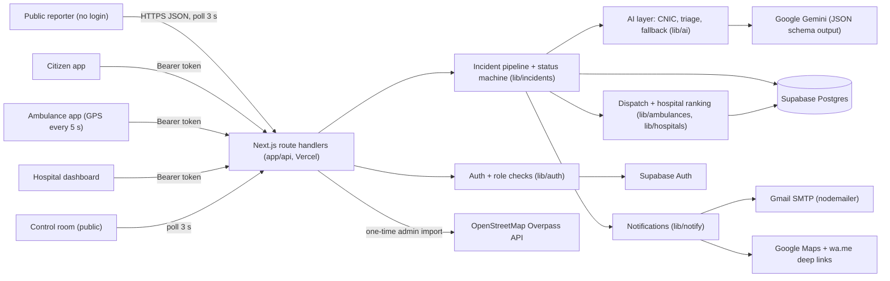

# RescueLink: Smart Ambulance & Emergency Response

**Build With AI, AICON'26 · Domain: Health Operations**

RescueLink connects the person who finds an accident victim, the nearest ambulance, and the right hospital in under a minute. It uses AI to read the victim's ID card, pull up their registered medical profile, triage the scene, and hand the ER a clinical brief before the patient arrives.

This is a working system, not a mock-up. It runs on real accounts, real CNIC reading, real hospitals from OpenStreetMap, real phone GPS, real Gemini calls and real email.

---

## 1. Problem

Road traffic injuries are one of Pakistan's biggest causes of avoidable death. Most of the damage is done in the first hour, and much of that hour is lost to things that have nothing to do with medicine:

- A passerby finds an unconscious rider and does not know who to call, what to say, or what to do.
- The victim's identity, blood group, allergies and medications (for example a blood thinner) are unknown, so the ER starts blind.
- The ambulance is dispatched by phone and memory, not by who is actually closest and properly equipped.
- The patient is taken to a hospital that has no neurosurgery, no free bed, or is not accepting, and has to be moved again.
- Relatives find out hours later.

**SDG target 3.6:** halve the number of global deaths and injuries from road traffic accidents. RescueLink goes after the minutes lost between the crash and definitive care.

## 2. Solution

### Who uses it
| Account | What they do |
|---|---|
| **Anyone, no login** | Reports an accident: GPS pin, description (English / Urdu / Roman Urdu), optional scene photo, optional photo of the victim's CNIC. Gets first-aid steps and tracks the ambulance live. **Emergency help never requires an account.** |
| **Citizen** | Registers an emergency profile by photographing their CNIC. Gemini fills in the CNIC number, name, DOB and gender; the citizen adds blood group, conditions, allergies, medications and an emergency contact. Can request an ambulance for themselves. |
| **Hospital** | Claims a real hospital (imported from OpenStreetMap) or creates one. Keeps capabilities, free ER beds and "accepting" up to date. Sees incoming patients with the full registered profile and an AI handover brief, and sets readiness. |
| **Ambulance** | Registers a vehicle (call sign, ALS/BLS, plate), goes online, and the phone sends GPS. Receives assignments, accepts or declines, sees the patient's pin with "Open in Google Maps", and taps At scene / Picked up / Arrived. |
| **Control room** | Public live map of ambulances, live hospitals and active incidents. No personal data. |

### End-to-end flow
1. **Report.** A passerby (no login) sends a GPS pin, description, optional scene photo and optional photo of the victim's CNIC.
2. **Identify.** Gemini vision reads the CNIC number. We look up the registered profile and cross-check the name. If it matches, the passerby sees only the first name, blood group and critical alerts.
3. **Triage.** One Gemini call takes the description, the photo and the victim's medical profile, and returns severity, category, required hospital capabilities, risk flags, first-aid steps, a handover brief and a message for the relative.
4. **Dispatch.** Online ambulances are ranked by straight-line distance, with ALS preferred for critical/serious cases. The best one is assigned.
5. **Hospital match.** We pick the nearest live hospital that has the required capabilities, has beds > 0 and is accepting. It gets the full patient profile and brief instantly.
6. **Notify.** Hospital dashboard, ambulance app, reporter and relative (real email via Gmail, plus a WhatsApp click-to-send link).
7. **Live tracking.** The ambulance phone posts GPS every 5 s. The caller sees the ambulance moving toward them, the crew sees the patient's pin, and the hospital sees distance and ETA. The driver taps the status buttons.
8. **Handover.** The hospital goes preparing -> ready -> close, and closing frees the bed.

## 3. Architecture



- Supabase is called **server-side only**, with the service-role key. Browsers never talk to Supabase directly.
- Live updates use polling every 3 s. There are no websockets, which keeps it simple and reliable on Vercel.
- API shapes are fixed in [`API_CONTRACT.md`](./API_CONTRACT.md). Frontend guide: [`FRONTEND_INTEGRATION.md`](./FRONTEND_INTEGRATION.md).

## 4. Where AI is used

**Model:** Google Gemini via `@google/genai`, chosen with the `GEMINI_MODEL` env var. Our deployment uses `gemini-3.8-flash`; the default in `.env.example` is `gemini-2.5-flash`. Every call uses `temperature: 0.1`, `responseMimeType: "application/json"` and a `responseSchema`, so the model can only return valid, typed JSON (`lib/ai/gemini.ts`).

### 4.1 CNIC vision extraction (`lib/ai/cnic.ts`)
A photo of the front of a Pakistani CNIC becomes `{ cnic, full_name, date_of_birth, gender, confidence }`. This is used twice: to auto-fill citizen registration, and to identify an unconscious victim from a passerby's photo. In the second case the server looks up the CNIC and cross-checks the name, returning `matched` / `name_mismatch` / `not_registered` / `unreadable`.

System prompt (verbatim):
```text
You read the FRONT side of a Pakistani CNIC / Smart National Identity Card. Extract the Identity Number (format 12345-1234567-1), the English Name (not the father/husband name), the Date of Birth (as YYYY-MM-DD; cards print DD.MM.YYYY) and the Gender (M/F). Return null for anything not clearly readable. Never guess or complete digits. If the image is not a CNIC, return all nulls with confidence low.
```
Schema: every field is a nullable string. `gender` is the enum `male | female`, and `confidence` is the enum `high | medium | low`.

### 4.2 Profile-aware multimodal triage, ATMIST handover brief and bilingual relative message (`lib/ai/triage.ts`)
**One** Gemini call takes the scene description (English / Urdu / Roman Urdu), the optional scene photo and the victim's registered medical profile. It returns three things:
- **Triage:** severity, category, suspected injuries, required hospital capabilities, ALS/BLS, profile-linked **risk flags**, and up to 5 bystander-safe first-aid steps.
- **Clinical handover brief:** a one-line summary, **ATMIST** (Age, Time, Mechanism, Injuries, Signs, Treatment) and a concrete ER prep checklist.
- **Relative message:** calm, English then Roman Urdu, with `{NAME} {HOSPITAL} {REF}` placeholders that the server fills in.

**Example, the reason the profile matters.** A motorcycle rider is unconscious and bleeding from the head. Their CNIC shows they take Warfarin 5 mg. The AI returns:
- risk flag: **"Warfarin + head injury: high risk of intracranial bleeding"**
- prep checklist: **"Prepare anticoagulation reversal"**, "Alert neurosurgery", "Cross-match B+ blood"
- required capabilities: `trauma, neuro, general`, which means a hospital without neuro is skipped.

The ER knows this before the ambulance arrives. Without the profile, nobody at the scene would have known.

System prompt (verbatim):
```text
You support — never replace — emergency dispatchers and ambulance crews in Pakistan. You output structured triage, an ER handover brief, and a message for the patient's relative. You are a decision-support tool, not the clinician of record.

LANGUAGE
- Callers may write in English, Urdu, or Roman Urdu (e.g. "behosh", "khoon", "sar", "seena", "saans", "jal gaya", "hamla", "takkar"). Understand all three.
- Write triage fields, brief, first-aid and reasoning in clear clinical English.

FACTS ONLY — DO NOT INVENT
- Use only the given scene description, optional photo, and optional registered medical profile.
- Do not invent vitals, GCS, clock times, ages, drugs given, or injuries that are not supported by those facts.
- If a field is unknown, write "unknown" (especially in ATMIST). Never complete missing digits or guess a name.
- When two severities are plausible, escalate (choose the more severe). When a capability is uncertain, include it.

required_capabilities — use ONLY this enum: trauma, cardiac, neuro, burns, pediatric, obstetric, general.
- ALWAYS include "general".
- "neuro": head injury with reduced consciousness, OR stroke signs (face droop, limb weakness, speech).
- "cardiac": chest pain, suspected ACS, arrhythmia, or cardiac arrest.
- "burns": significant thermal, chemical or electrical burns.
- "obstetric": the patient is pregnant, or this is a labour / pregnancy emergency.
- "trauma": collision, fall, blunt/penetrating injury, or traumatic bleeding.
- "pediatric": the patient is clearly a child.

vehicle_needed
- "ALS" if severity is critical or serious, OR there is any airway, cardiac, stroke, or major-bleeding risk (including anticoagulant + head injury or bleeding).
- Otherwise "BLS".

risk_flags
- If no registered profile was provided, return an empty array.
- If a profile was provided, every flag MUST explicitly link a profile fact (medication, condition, allergy, or blood group) to the suspected injuries. Example: "Warfarin + head injury: high risk of intracranial bleeding".
- Do not dump the whole profile. Skip facts that do not change this scene.

first_aid_steps
- Maximum 5. Safe for an untrained bystander in Pakistan (no drugs, no procedures, no "recovery position" if a neck injury is possible).
- Typical: do not move the neck if head/spine injury is possible; firm pressure on bleeding; no food or water if consciousness is reduced; cool a burn under running water, never ice/toothpaste/ghee.

brief
- summary: one clinical sentence. If there is no profile, it MUST contain the words "Identity unknown".
- atmist: concise clinical shorthand for Age, Time, Mechanism, Injuries, Signs, Treatment. Unknown → "unknown".
- prep_checklist: concrete ER actions, not slogans. Examples: "Prepare anticoagulation reversal", "Cross-match B+ blood", "Alert neurosurgery", "ECG on arrival".

relative_message
- Calm, 2–3 sentences. English first, then the same meaning in Roman Urdu.
- No graphic detail (no blood, wounds, or dying).
- MUST contain these placeholders exactly, for later substitution: {NAME} {HOSPITAL} {REF}
```

**Structured output schema** (`responseSchema`, every field required):
- `triage.severity`: enum `critical | serious | moderate | minor`
- `triage.category`: enum `trauma | cardiac | stroke | burns | respiratory | obstetric | pediatric | other`
- `triage.required_capabilities[]`: enum `trauma | cardiac | neuro | burns | pediatric | obstetric | general`
- `triage.vehicle_needed`: enum `ALS | BLS`
- `triage.suspected_injuries[]`, `risk_flags[]`, `first_aid_steps[]`, `reasoning`: strings
- `brief.summary`, `brief.atmist.{age,time,mechanism,injuries,signs,treatment}`, `brief.prep_checklist[]`: strings
- `relative_message`: string

After the model replies, the server applies these guardrails: unknown capabilities are dropped and `general` is always added; at most 5 first-aid steps are kept; risk flags are cleared when there is no profile; "Identity unknown" is added to the summary when there is no profile; and the relative message is checked for its placeholders.

### 4.3 Rule-based fallback: AI supports, never blocks (`lib/ai/fallback.ts`)
If Gemini is overloaded (503/429) or slow, the call first fails over from `GEMINI_MODEL` to `GEMINI_FALLBACK_MODEL` (default `gemini-2.5-flash`) inside one deadline (20 s by default, 40 s for the multimodal triage call). If that also times out, errors, or returns invalid JSON (retried once), the pipeline switches to a deterministic keyword triage and marks it `source: "fallback"`. The fallback understands **English and Roman Urdu** keywords: *behosh* (unconscious), *khoon* (blood), *sar* (head), *seena* (chest), *saans* (breath), *jal gaya* (burned), *hamla* (pregnant), *takkar* (collision), *falij* (stroke), *bacha* (child) and more. It still produces profile-linked risk flags, including "Warfarin 5 mg + head injury: high risk of intracranial bleeding" -> "Prepare anticoagulation reversal". It also produces bystander first aid, an ATMIST brief and a bilingual relative message. **An ambulance is dispatched either way.**

### 4.4 What is deliberately NOT AI
| Decision | How it is made |
|---|---|
| Ambulance ranking | Online ambulances are scored by estimated ETA from straight-line distance. When ALS is needed, a BLS vehicle gets a **+5 min penalty**, so a nearby BLS still wins over a far-away ALS. |
| Hospital matching | A hard filter (has the required capabilities, ER beds > 0, accepting), then the nearest to the scene. Every skipped hospital gets a `skip_reason`. |
| Incident status | A strict state machine: assigned -> en_route -> at_scene -> transporting -> arrived -> closed (plus `no_ambulance`). |

**Why:** these are life-critical allocation decisions. They must be deterministic, explainable and auditable. Every incident stores `dispatch_decision` and `hospital_decision`, each with the full **candidate list** and a human-readable **`chosen_reason`**, so a supervisor can see exactly why ambulance X and hospital Y were chosen. AI does the parts that need perception and language: reading ID cards, understanding messy multilingual descriptions and photos, and writing clinical summaries.

## 5. Real vs simulated

| Area | Status |
|---|---|
| Accounts (citizen / hospital / ambulance) | **Real**: Supabase Auth, email + password |
| Database | **Real**: Supabase Postgres |
| Hospitals | **Real**: imported from OpenStreetMap (Islamabad + Rawalpindi) via Overpass |
| Ambulance position | **Real** phone GPS (`watchPosition`, every 5 s). For indoor demos the driver can tap the map to set the position |
| AI (CNIC reading, triage, brief, relative message) | **Real** Gemini calls |
| Relative email | **Real** Gmail SMTP. A WhatsApp click-to-send link is also generated |
| ETA | **Simulated**: straight-line km x 1.3 / 30 km/h, labelled `eta_source: "estimate"` |
| Road routing / traffic | **Not built**: navigation is handed to a Google Maps deep link |
| Identity verification | **No NADRA link**: the CNIC number is read by AI and cross-checked against the name on our registered profile |

## 6. Privacy & responsible AI
- **CNIC images are never stored.** They are processed in memory and dropped after the request.
- **Consent only.** Real CNICs are registered only by their owners, who choose to create an emergency profile.
- **Role-based access.**
  - Full medical profile: only the hospital receiving that patient.
  - Assigned crew: limited profile plus the brief.
  - Public / passerby: first name, blood group and critical alerts only. Any other hospital or ambulance account gets 403.
- **CNICs are masked in logs** (`35202-*****01-1`). Base64 images are never logged.
- **AI supports, never blocks.** If Gemini fails or is slow, the rule-based fallback runs (`source: "fallback"`) and dispatch continues. The demo never crashes, and an email failure is recorded as `delivered: false` without failing the request.
- **Identity is never required for help.** Unknown victims get the same dispatch, and the brief says "Identity unknown".
- **Decision support, not diagnosis.** The prompt forbids inventing vitals, ages or injuries, and tells the model to escalate when unsure.

## 7. Third-party disclosure
- [Next.js](https://nextjs.org) (App Router, TypeScript, Tailwind), deployed on Vercel
- [Supabase](https://supabase.com) (Auth + Postgres)
- [Google Gemini](https://ai.google.dev) via `@google/genai`
- [OpenStreetMap](https://www.openstreetmap.org) data via the [Overpass API](https://overpass-api.de); OSM map tiles (© OpenStreetMap contributors)
- [Leaflet](https://leafletjs.com) / [react-leaflet](https://react-leaflet.js.org)
- [nodemailer](https://nodemailer.com) (Gmail SMTP)
- Google Maps deep links (navigation), `wa.me` links (WhatsApp click-to-send)
- [zod](https://zod.dev) (request validation)
- **Claude Code** was used as a coding assistant.

All code was written during AICON'26.

## 8. Run locally

```bash
npm install
cp .env.example .env.local   # then fill in the values
npm run dev                  # http://localhost:3000
```

| Variable | Required | Purpose |
|---|---|---|
| `SUPABASE_URL` | yes | Supabase project URL |
| `SUPABASE_SECRET_KEY` | yes | Supabase secret / service-role key (**server only**) |
| `GEMINI_API_KEY` | yes | Google AI Studio key (without it, everything runs on the fallback) |
| `GEMINI_MODEL` | yes | e.g. `gemini-2.5-flash` |
| `GEMINI_FALLBACK_MODEL` | no | used when the primary model is overloaded; default `gemini-2.5-flash` |
| `GMAIL_USER` | optional | Gmail address used to send relative emails |
| `GMAIL_APP_PASSWORD` | optional | Gmail app password. If either Gmail var is missing, email is skipped (`delivered: false`) |
| `ADMIN_SECRET` | yes | Protects `/api/admin/*` (header `x-admin-secret`) |

1. **Database:** open the Supabase SQL editor and run [`schema.sql`](./schema.sql).
2. **Import real hospitals** (one time):
   ```bash
   curl -X POST http://localhost:3000/api/admin/import-hospitals -H "x-admin-secret: <ADMIN_SECRET>"
   ```
   On Windows PowerShell, use `curl.exe` instead of `curl`.
3. **Health check:** `GET http://localhost:3000/api/health` -> `{ ok, supabase, gemini, email }`.
4. **Test UI:** http://localhost:3000/test
5. **End-to-end test:** creates fresh hospital, ambulance and citizen accounts, claims one unclaimed hospital, runs the whole incident lifecycle and checks the privacy rules:
   ```bash
   node scripts/e2e.mjs http://localhost:3000 <ADMIN_SECRET>          # add --reset to wipe incidents afterwards
   node scripts/watch.mjs http://localhost:3000 <incidentId>          # live tracking in the terminal
   ```
   For the dispatch check to pass, no other ambulance may be online closer to the scene. The script prints SQL to unclaim the test hospital afterwards.

## 9. Next steps
- Road routing and live traffic for real ETAs
- Realtime / websockets instead of polling
- NADRA-authorised identity verification
- Integration with Rescue 1122 and call centres (shared dispatch board, call-taker console)
- Urdu voice reporting (speech -> triage) for callers who cannot type

---

## Demo script (5 min)

| Time | What happens | Who / screen |
|---|---|---|
| 0:00-0:30 | The problem in one sentence, plus SDG 3.6. "A rider is down on Islamabad Expressway. Nobody knows who he is or that he takes blood thinners." | Speaker |
| 0:30-1:00 | Citizen app: photograph a (consenting teammate's) CNIC. Gemini fills in the number, name, DOB and gender. Add B+, a penicillin allergy and Warfarin. Save. | Phone 1 (citizen) |
| 1:00-1:30 | Hospital dashboard: a claimed real OSM hospital with trauma + neuro, 3 beds, accepting. Ambulance phone: goes online, GPS dot appears on the control room map. | Laptop (hospital), Phone 2 (ambulance), projector (control) |
| 1:30-2:30 | Passerby, **no login**: GPS pin, "Motorcycle accident, rider unconscious, bleeding from the head", photo of the victim's CNIC -> "Matched: Ali, B+, Takes warfarin". Submit. Within seconds: severity critical, first-aid steps, ambulance and hospital assigned. | Phone 3 (reporter) |
| 2:30-3:15 | Hospital dashboard: the full profile and ATMIST brief arrive. Point at **"Warfarin + head injury: high risk of intracranial bleeding" -> "Prepare anticoagulation reversal"**. Show the `chosen_reason` for the ambulance and hospital. Relative email arrives, plus the WhatsApp link. | Laptop |
| 3:15-4:15 | Ambulance accepts, taps "Open in Google Maps", then moves (drive, or tap the map indoors). The reporter's screen shows the ambulance approaching with distance and ETA. At scene -> Picked up -> Arrived. Hospital: preparing -> ready -> close (bed freed). | All screens |
| 4:15-5:00 | Real vs simulated, privacy (CNIC never stored, role-based views, fallback), next steps. | Speaker |

Backup: if Wi-Fi or Gemini fails, the fallback triage still dispatches (`source: "fallback"`). `node scripts/e2e.mjs` proves the full flow from a terminal.

## 8-slide deck outline
1. **Problem.** The golden hour lost to an unknown identity, phone-based dispatch and the wrong hospital. Pakistan road-traffic burden.
2. **Solution in one picture.** Problem -> Data (CNIC, medical profile, GPS, real hospitals) -> AI (read, triage, brief) -> Output (dispatch, hospital match, notifications) -> Impact (minutes saved, right hospital first time).
3. **AI depth.** Three AI tasks: CNIC vision extraction, profile-aware multimodal triage, and the ATMIST handover brief with a bilingual relative message. Structured JSON schema plus fallback. The warfarin example: "Warfarin + head injury: high risk of intracranial bleeding" -> "Prepare anticoagulation reversal".
4. **Live demo.** Reporter -> ambulance -> hospital, live.
5. **Smart dispatch + hospital matching.** Deterministic ETA ranking with an ALS preference, and a capability / beds / accepting filter with the nearest hospital chosen. Every decision ships with `chosen_reason` and the candidate list.
6. **SDG 3.6 impact.** Faster dispatch, no inter-hospital transfers, the ER prepared before arrival, relatives informed in minutes.
7. **Industrial impact.** For 1122 / Edhi-type fleets, public and private hospitals, and insurers (verified incident records). Free / low-cost stack (Vercel, Supabase, Gemini Flash, OSM). Path to a national rollout.
8. **Real vs simulated + privacy + next steps.** ETA is an estimate, no NADRA link, indoor map-tap. CNIC images never stored, role-based views. Next: routing and traffic, realtime, NADRA, 1122 integration, Urdu voice.
